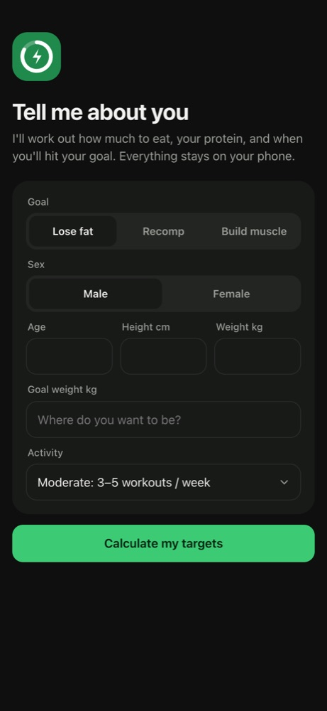

# Fuel

A personal nutrition tracker you install on your phone: photograph a meal, get calories and macros back, and follow your weight and physique over time.



## What it does

- **Meal scan**: take a photo (or just describe the meal) and get a per-item breakdown: grams, calories, protein, carbs, fat, plus a confidence level. Fix any gram value and the numbers rescale live.
- **Daily targets**: calories and macros worked out from your profile and goal (lose fat, recomp, build muscle), with a weekly pace and an estimated goal date.
- **Progress**: weight trend chart, last-7-days calorie bars, average intake.
- **Coach**: asks the model to review your targets against your recent intake and weight log, and gives feedback on progress photos compared with the previous check-in.
- **Private by default**: everything you log stays on the phone in IndexedDB. Photos only leave the device when you press Analyze or Get feedback.

## Engineering highlights

- **No backend database.** Profile, targets, meals, weigh-ins and check-ins live in a small promise-based key-value wrapper over IndexedDB (`public/app.js`). The server is stateless; backup is a JSON export from the Me tab.
- **The Worker is a thin, typed proxy.** `src/index.ts` keeps the API key server-side, gates `/api/*` behind a shared passcode header, and exposes three POST routes (`scan`, `plan`, `physique`). Static assets are served by the same Worker, with `run_worker_first` limited to `/api/*`.
- **Structured output instead of prompt parsing.** Each route sends a strict JSON Schema (`additionalProperties: false`, every field required), so the client renders the response directly. Reasoning effort is tuned per route: `low` for meal scans, `medium` for the coach.
- **Explicit failure paths.** SDK errors are mapped to meaningful HTTP statuses (auth, rate limit, bad request, upstream), refusals and truncated answers are handled separately, and images are validated by MIME type and size before any upstream call.
- **Photos are shrunk on the device.** Images are downscaled on a canvas to 1280 px JPEG before upload, and a separate small thumbnail is what gets stored with each meal.
- **Deterministic target maths.** Targets come from the Mifflin-St Jeor equation, an activity multiplier and a goal-specific weekly rate, with a capped deficit and calorie floors. Formula targets recalculate on every weigh-in; targets set by the coach or by hand stay fixed until you switch back.
- **No framework, no build step on the client.** One ES module, delegated event handling via `data-action`, hand-written SVG for the calorie ring and charts, and HTML escaping of user and model text before it reaches the DOM.

## Tech stack

- Cloudflare Workers (TypeScript) with static assets, run with Wrangler
- `@anthropic-ai/sdk` calling the Claude API (vision + JSON-schema output)
- Vanilla HTML, CSS and JavaScript, IndexedDB, service worker, web app manifest
- Light and dark themes, iOS safe-area aware layout

## Project structure

```
src/index.ts              Worker: passcode check, /api/scan, /api/plan, /api/physique, mock mode
public/index.html         App shell: tab bar, bottom sheet, hidden file inputs
public/app.js             Storage, nutrition maths, views, scan and check-in flows
public/styles.css         Styling
public/sw.js              Network-first cache of the app shell, offline fallback
public/manifest.webmanifest, public/icons/   Install metadata and icons
wrangler.jsonc            Worker config and assets binding
.dev.vars.example         Template for local secrets
```

## Getting started

Requires Node.js and npm.

```bash
npm install
cp .dev.vars.example .dev.vars
npm run dev          # http://localhost:8787
```

Variables in `.dev.vars` (never commit this file):

| Name | Purpose |
| --- | --- |
| `ANTHROPIC_API_KEY` | Key the Worker uses to call the Claude API |
| `APP_PASSCODE` | Shared secret the app must send with every API request |
| `MOCK` | Optional. Set to `1` to return canned results without calling the API |

In the app, open **Me → App passcode** and enter the same passcode. `npm run dev` binds to `0.0.0.0`, so a phone on the same network can reach it. `npm run typecheck` runs `tsc --noEmit`.

### Deploy and install on a phone

```bash
npx wrangler login
npx wrangler secret put ANTHROPIC_API_KEY
npx wrangler secret put APP_PASSCODE
npm run deploy
```

1. Open the URL Wrangler prints (`https://fuel.<your-subdomain>.workers.dev`) in Safari on the iPhone.
2. Share → **Add to Home Screen**.
3. Open Fuel from the home screen, then **Me → App passcode** and enter your passcode.

### Backups

Data lives only in the phone's browser storage, and deleting the home-screen app deletes it. Use **Me → Export backup** now and then. The export contains your photos and body data, so keep it out of the repository.

## Status

Personal project, built for my own daily use. It is a working single-user app, not a hosted service: there are no accounts, no sync between devices, no import for backups and no automated tests. Access control is one shared passcode with no rate limiting, which is enough to protect a private deployment's API credit and nothing more. Nutrition and body-fat figures are model estimates and general fitness guidance, not medical advice.

Built by [Hamza Dellai](https://github.com/devhmez).
